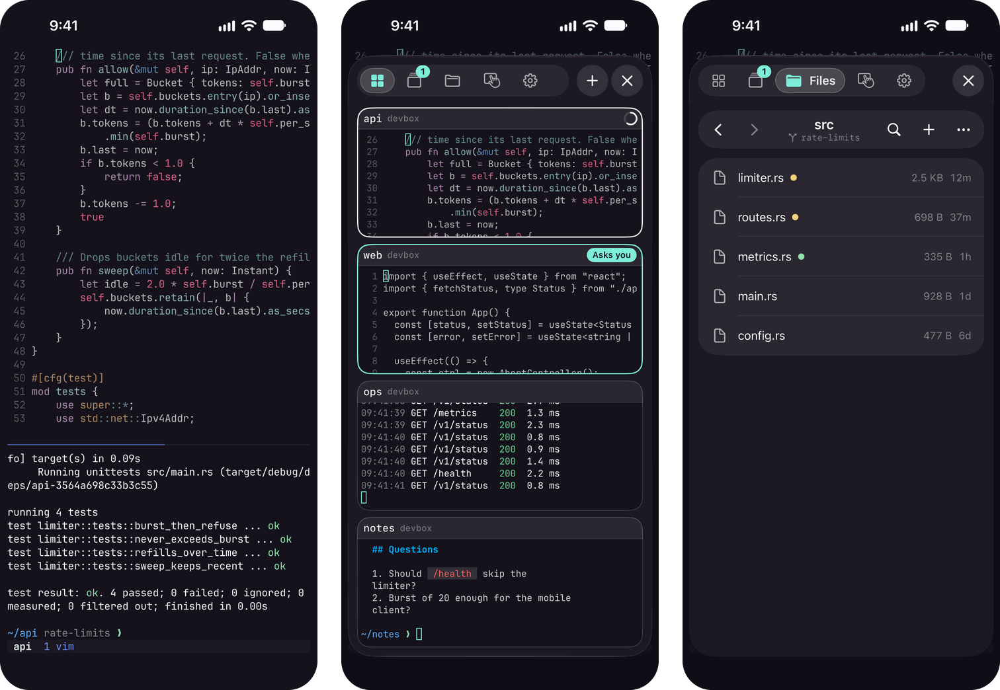
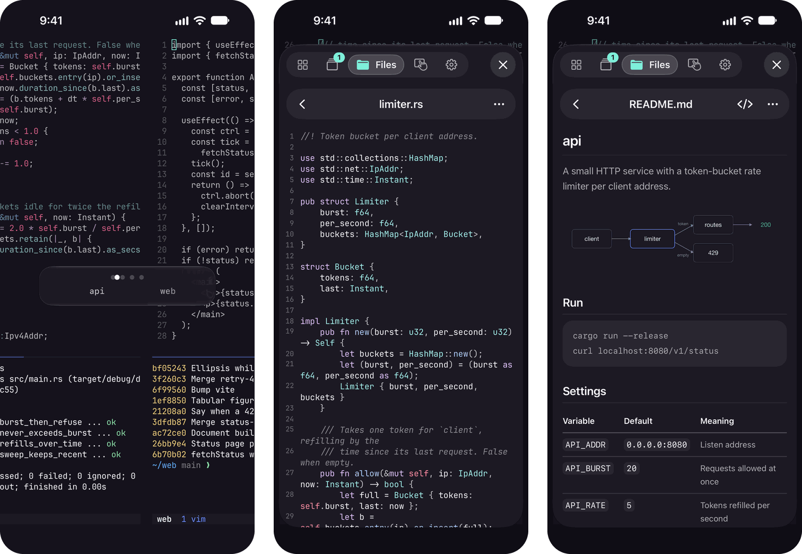
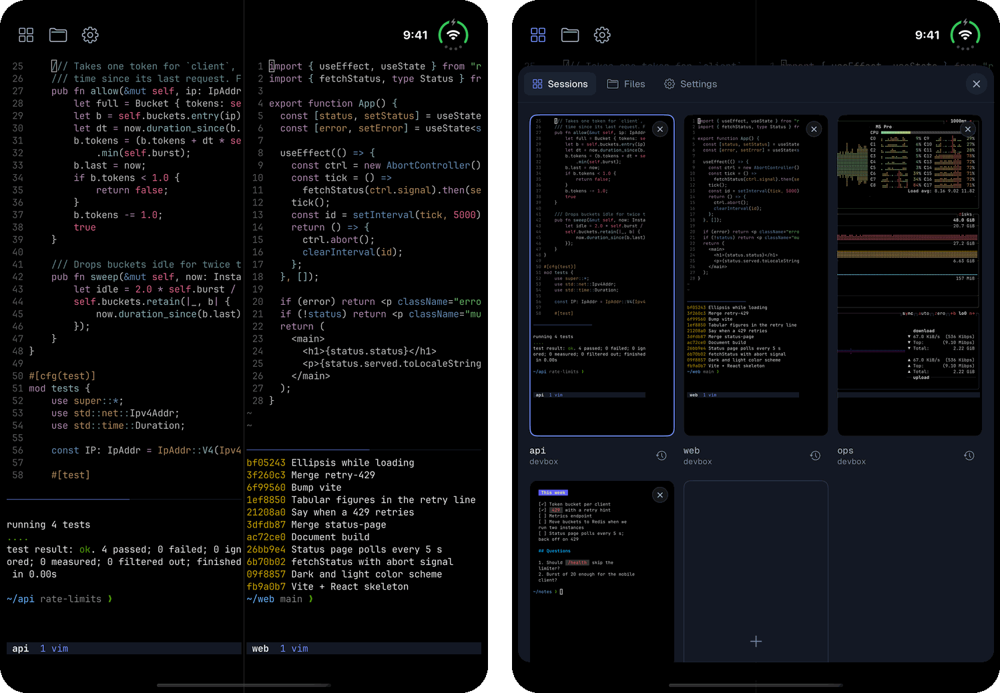
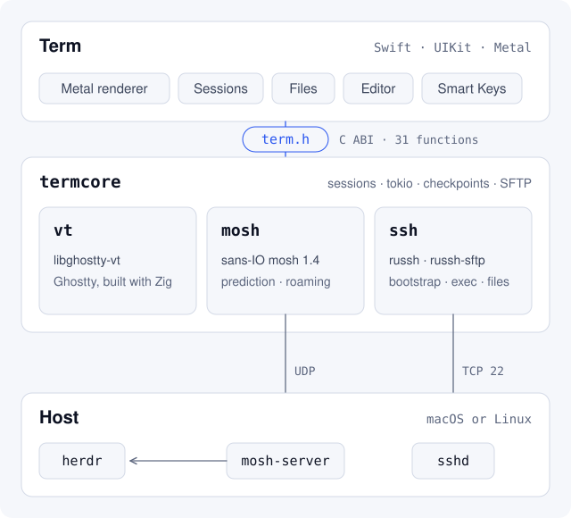
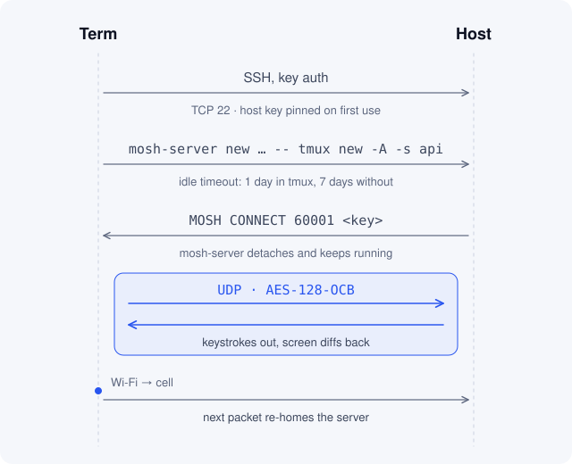
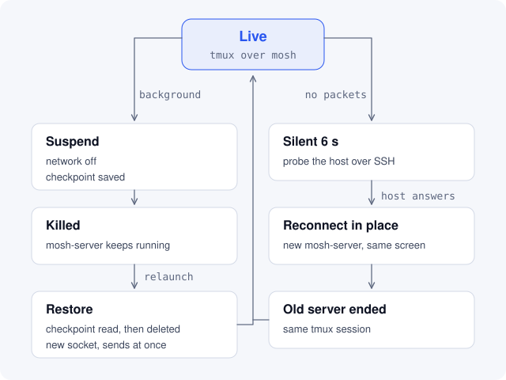

# Term

Term is a terminal for iPhone. It speaks mosh and SSH, keeps your tmux sessions one swipe away, and lets you work on the remote machine's files without leaving the app.

<p align="center">
  
</p>

Term takes [Blink Shell](https://blink.sh) as its model and rebuilds it on [Ghostty](https://ghostty.org)'s terminal engine, with a mosh client written from scratch in Rust.

## What it does

- **mosh that survives iOS.** Local echo prediction, roaming between Wi-Fi and cellular, and sessions that come back after iOS kills the app in the background.
- **SSH** with Ed25519 keys made or imported in the app. Host keys are pinned on first use.
- **tmux, native.** A tmux tab lists every session on your hosts, one line each: tap one to open it in a window, long-press to see its screen, swipe or select to close them. Plus a scrollable history viewer, an overview of your open windows (three fingers up), and a swipe between windows that names where you're going.
- **Agents that tell you when they stop.** With the omp extension below, the tmux tab shows what each [omp](https://github.com/can1357/oh-my-pi) agent is working on and how far through its todo list it is. A session whose agent finished, failed or asks you something shows the answer or question under its name, and the tab's icon counts them; a long press shows the whole answer with its model, context, cost and branch. Entering the session or clearing it there quiets it on every device.
- **Reconnect in place.** Term remembers tmux sessions entered from a shell as well as those opened from its tmux tab. Mosh reconnects automatically when contact is lost; Reconnect also works on SSH. Both attach to the same session, never recreating a missing session empty.
- **Files on the host**, over SFTP: git status in the listing, search, upload and download, a code editor with syntax highlighting, and viewers for Markdown, images, PDF and video. Saves check that nobody changed the file on the host first.
- **Your Mac's screen**, the way [Screens](https://edovia.com/screens) does it: a Screen tab streams each of the Mac's displays as hardware video through a small app on the Mac. Drag anywhere to move the pointer, tap to click, two fingers to scroll with momentum, pinch to zoom while moving the picture anywhere (even past its edges, above the keyboard), press and hold to drag; Screens' toolbar with its modifier keys, arrows and edit keys. Both displays show in their arrangement, and the strip above the picture shows just one in one tap. The picture's quality adapts to the connection, or you pick it. The clipboard follows both ways, text and images. When the Mac is locked, Term signs in to its Screen Sharing so you can unlock it.
- **A floating menu** for Sessions, tmux, Files, Screen and Settings: double-tap ⌘ on the Smart Keys bar, or tap with three fingers.
- **Smart Keys** for Esc, Ctrl, Alt, symbols and arrows, with configurable key repeat.
- **Pinch to resize.** JetBrains Mono and Iosevka Nerd Fonts are built in.
- **Your look.** Settings › Appearance picks from 823 terminal themes (searchable, with a live preview; Term's own Dusk unless you pick another) or one you import as a Ghostty theme or `.itermcolors` file, the font, size and line height, and the cursor: block, bar or underline, blinking or steady, and whether programs like vim may change it. The app's own colors follow the terminal theme, on clear or tinted glass, with the text size, home screen icon and haptics yours to pick.
- **iPhone Duo layouts** for both displays, two windows side by side, and a menu dock in the inner display's status band.

<p align="center">
  
</p>

<p align="center">
  
</p>

## How it works

The app is Swift and UIKit with its own Metal renderer. Everything that touches the network or the terminal state lives in a Rust core. The two meet in one C header, [`term.h`](core/termcore/include/term.h), and nothing else crosses.

<p align="center">
  <picture>
    <source media="(prefers-color-scheme: dark)" srcset="docs/architecture-dark.svg">
    
  </picture>
</p>

`vt` wraps libghostty-vt, Ghostty's terminal emulator as a library, built from a pinned Ghostty commit with Zig. Swift never calls it. The core resolves every cell's colors and hands the app a flat frame to draw.

`mosh` is a sans-IO client for the mosh 1.4 protocol: time and datagrams go in, datagrams come out. That shape is why the same code can run in unit tests, against a real mosh-server, and under a model checker.

`ssh` is [russh](https://github.com/Eugeny/russh). It starts mosh-server, runs the commands behind the tmux tab and history, and carries SFTP for Files.

tmux on the host is the session store. Term doesn't replace it. The phone lists sessions with `tmux list-sessions`, reads a tab's history with `tmux capture-pane` (a tab outside tmux shows its own scrollback), and attaches with `tmux new -A -s NAME`, so the same sessions open on the phone and on the computer.

Term learns a tab's client on the host's default tmux server through process ancestry over SSH, without changing the host's configuration or terminal output. It checks while the app is active, before reconnecting, and before opening a session from the tmux tab. The learned name labels the existing terminal, so selecting that session switches to it rather than opening a duplicate. A manually attached session returns to a login shell when it ends. SSH retains its last observation after a lost connection: an attach or detach between the last successful check and the drop cannot be recovered; mosh can usually inspect its surviving server before replacing it.

### omp agents

[`integrations/omp/term-agent.ts`](integrations/omp/term-agent.ts) is an omp extension. Inside tmux it keeps the agent's state in its pane as the user option `@agent`, a small JSON value (state, title, current step, todo progress, the question it asks, its last answer, model, context, cost), rewritten as the state changes and every 30 seconds. When you prompt or answer omp it sets the session option `@seen`, and Term does the same when you enter the session or clear its notification, so a stop you've seen stays quiet on every device. Outside tmux it does nothing. To install it on a host:

```sh
ln -s "$PWD/integrations/omp/term-agent.ts" ~/.omp/agent/extensions/term-agent.ts
```

New omp sessions load it. Without it, Term still reads omp's terminal title for working, asks you or idle.

Cancelled or unfinished runs report **aborted**, not done. Stops and acknowledgements use fractional Unix seconds (older integer values still work); Term acknowledges the stop it displayed, so a later stop cannot be cleared by a delayed request. Exiting omp drains its pending update before removing `@agent`.

Set omp to repaint only the screen when its terminal changes size: `omp config set tui.resizeScrollback preserve`. With `rebuild`, a resize (the keyboard rising, a rotation) makes omp erase tmux's history and write its whole transcript again, which on a long session takes seconds and scrolls past on the phone. Term keeps tabs that are off screen at the size of the one in front and hands keyboard focus directly between terminals, so switching tabs keeps the keyboard in place and resizes nothing.

Mermaid drawings use the sources published by the omp extension. While tmux scrolls, Term keeps each identified drawing's row bounds and clips the same image at the screen edges; it does not resize the image to the visible fragment. Source matching and image rendering run off the display thread. An unidentified fragment or a drawing still rendering remains text until it can be identified.

### Connecting

<p align="center">
  <picture>
    <source media="(prefers-color-scheme: dark)" srcset="docs/connect-dark.svg">
    
  </picture>
</p>

SSH only starts the server. From then on it's encrypted UDP, and the server follows the phone to whatever address its packets come from next.

mosh-server exits on its own after a day without hearing from the phone when the session lives in tmux, and after a week for a plain shell. Inside tmux nothing is lost when it goes, and Term reconnects in place the next time you look.

### Surviving iOS

<p align="center">
  <picture>
    <source media="(prefers-color-scheme: dark)" srcset="docs/lifecycle-dark.svg">
    
  </picture>
</p>

iOS suspends background apps and kills them when it needs the memory. So when Term goes to the background, it stops the network and writes each mosh session's protocol state to disk. On the next launch it reads the checkpoint, deletes it, and resumes on a fresh socket with the same mosh-server.

The order matters, and it's where the bugs hide: a reused encryption nonce, or a checkpoint that names a server a reconnect already ended. So that part is formally checked, below.

The other path handles a server that's gone. Once a session has been silent for about 6 seconds, Term probes the host over SSH. If the host answers, it starts a new mosh-server and ends the old one, and you're back in the same tmux session. In the simulator, after `kill -9` on the server, the session came back on its own, without a tap.

### Screen

The Screen tab talks to Term Screen Host ([`mac/ScreenHost`](mac/ScreenHost)), a small app that runs on the Mac as a LaunchAgent. It captures each display with ScreenCaptureKit, encodes HEVC on the media engine, posts the phone's pointer, scroll and key events, and reads and writes the clipboard. The phone draws the pointer itself, at the picture's scale, so moving it never waits for the network; it sends the Mac one move per display frame. A still screen gets one sharper frame about 0.4 s after it stops changing, so text is crisp.

Actions › Quality sets how the host trades picture for speed. High streams native pixels at the full bitrate, Medium three quarters of the pixels on each axis at half the bitrate, Low half on each axis at a quarter (sizes rounded down to even pixels). Adaptive, the default, starts at High, drops a level after two one-second samples in which the phone fell behind, changes at most every 5 s, and climbs back a level after 15 seconds of frames sent without falling behind; a still screen pauses that count rather than adding to it.

The host listens on a Unix socket in `~/.term` and accepts only connections that arrive through sshd. Term reaches it over its SSH connection to the Mac (a streamlocal channel), so nothing new listens on the network. Both ends compile one Swift file, [`ScreenProtocol.swift`](mac/ScreenHost/Sources/ScreenProtocol/ScreenProtocol.swift), as the wire format.

A locked Mac stops screen capture, so Term switches to the Mac's own Screen Sharing (RFB with Apple's authentication; the client is [`core/vnc`](core/vnc)) through the same SSH connection, and back once the Mac is unlocked. A Mac unlocked through Screen Sharing locks again when that session ends, so Term keeps it open until you leave the Screen.

## Build

You need Xcode 27.1 (the iOS 27.1 SDK has the iPhone Duo APIs), Rust with the iOS targets, and [XcodeGen](https://github.com/yonaskolb/XcodeGen). The Ghostty step downloads its own pinned Zig.

```sh
rustup target add aarch64-apple-ios aarch64-apple-ios-sim
brew install xcodegen
export DEVELOPER_DIR=/Applications/Xcode.app/Contents/Developer

scripts/build-core.sh          # libghostty-vt (pinned Ghostty + Zig, ~2.5 min the first time, then cached)
                               # and the Rust core -> build/TermCore.xcframework
cd app && xcodegen generate
```

Simulator builds need no signing:

```sh
xcodebuild -project Term.xcodeproj -scheme Term \
  -destination 'platform=iOS Simulator,name=<simulator name>' build
```

To install on a phone, put your bundle ID and team in `app/Config/Local.xcconfig`. It's git-ignored, and [`Signing.xcconfig`](app/Config/Signing.xcconfig) includes it:

```
TERM_BUNDLE_ID = com.yourname.term
DEVELOPMENT_TEAM = ABCDE12345
```

Then build, install and launch:

```sh
xcodebuild -project Term.xcodeproj -scheme Term -destination 'generic/platform=iOS' \
  -derivedDataPath ../local/DerivedDataDevice build
xcrun devicectl device install app --device <udid> ../local/DerivedDataDevice/Build/Products/Debug-iphoneos/Term.app
xcrun devicectl device process launch --device <udid> com.yourname.term
```

The computer you connect to needs `mosh-server` (mosh 1.4) on its PATH or in Homebrew's usual place. tmux is optional, but it's what makes sessions shared and reconnects seamless.

For the Screen tab, run this on the Mac. It builds Term Screen Host, signs it with the Apple Development identity of `DEVELOPMENT_TEAM` (so its privacy grants survive reinstalls), installs it in `~/Applications` and starts its LaunchAgent:

```sh
scripts/install-screen-host.sh             # --uninstall removes it
```

Then allow Term Screen Host in System Settings › Privacy & Security under Screen & System Audio Recording and Accessibility, and allow its first paste from other apps. For a locked Mac, turn on Screen Sharing (General › Sharing); Term asks once for the Mac account's password and keeps it in the Keychain.

## Tests and formal checks

```sh
cd core && cargo test --workspace          # includes runs against a real sshd and mosh-server on 127.0.0.1
cd app && xcodebuild test -project Term.xcodeproj -scheme Term \
  -destination 'platform=iOS Simulator,name=<simulator name>'
python3 formal/mosh-resume.py              # TLA+ models, about 20 s
python3 formal/mosh-fragment.py fallback   # property tests, about 2 s (25 s on a cold build)
bun test integrations/omp/term-agent.test.ts # extension lifecycle; needs tmux and python3
cd mac/ScreenHost && swift test            # host input, framing, clipboard, privacy and adaptive quality checks
```

`KeyboardSwipeTests` and `KeyboardHandoffTests` check focus, input, compact-phone rotation and per-frame keyboard geometry. `KeyboardSwipeRemoteTests` also counts tmux resizes during slow, fast and cancelled swipes in both directions, with two and three tabs. It uses the optional private SSH fixture `local/e2e/reconnect.json` (`user` and `port`) and `local/e2e/client_key`, on the isolated `tmux -L termtest` server. The tests drive the controller's gesture states; they require a foreground simulator with the software keyboard visible. Remote counters are positively controlled by hiding and showing the keyboard before each swipe matrix. `-collect-test-diagnostics never` avoids Xcode's post-test simulator diagnostic collection.

To record diagram scrolling, configure a private SSH fixture in `local/e2e`: `reconnect.json` contains `{"user":"<test account>","port":<test sshd port>}`, and `client_key` authenticates it. The opt-in test creates and removes only its own session on `tmux -L termtest`; it publishes seven diagram sources, then drives Term's wheel and momentum paths through copy-mode. Build the app and tests with `build-for-testing`, then run:

```sh
python3 scripts/verify-diagram-scroll.py <simulator-udid> <label> --derived-data <build-directory>
```

Recordings go to `local/diagram-scroll`. The command selects display 1 (the Duo's outer display); `--display` selects another active display. `--profile` separately measures synchronous main-thread frame handling, including the terminal renderer. It bypasses display-link coalescing, so its recording is a benchmark, not visual acceptance evidence; the numbers are not device frame rates and exclude asynchronous completion callbacks.

`mosh-resume.py` runs two TLA+ models with TLC. The first checks that suspend, save, kill and restore, run twice with lost, duplicated and reordered packets within small bounds, never reuses an encryption nonce or loses the state needed to apply the server's next update. The second checks that a reconnect racing a suspend never leaves a checkpoint pointing at a server it ended. Before TLC runs, the script executes a probe against the real mosh crate and checks fingerprints of the Rust functions the models describe, so a model can't quietly drift from the code. It needs Java 21 and downloads a checksum-pinned TLC.

`mosh-fragment.py fallback` runs property tests on the real fragment reassembly code: arbitrary bytes never panic, and fragments in any order, duplicated, reassemble to exactly the original. These are sampled checks, not an exhaustive proof. An attempt with Kani timed out.

Both checks were seen to fail on deliberate bugs planted in a scratch copy of the code. The details, bounds and assumptions are in [`.omp/skills`](.omp/skills).

`ScreenHostProbe` checks a running host end to end. It only connects through sshd, so forward the host's socket first (`ssh -L /tmp/screen.sock:<home>/.term/screen.sock <mac>`). Then `swift run -c release ScreenHostProbe --socket /tmp/screen.sock --output <folder>` saves a decoded frame of each display. With `--quality` it instead covers both displays with its own full-screen window for about a minute and checks each fixed level's pixel size and bitrate, adaptive stepping down and back up, the pointer's first image and its echo.

## Status

Term is installed and tested end to end on an iPhone 11. A few things are not proven yet:

- There is no App Store or TestFlight build. You build it yourself.
- iPhone Duo layouts are verified in the simulator, not on Duo hardware.
- Roaming between networks is covered by the formal model and the interop tests, not by long field use on cellular.
- Composed input (CJK, dead-key accents) is untested.
- The Screen tab has been used on an iPhone Duo over cellular. Its adaptive quality is measured against a client throttled on the Mac, not on a cellular link.

## Layout

```
app/                    Swift app (UIKit + Metal), XcodeGen project in project.yml
  Sources/Terminal      renderer, input, gestures, Smart Keys
  Sources/Shell         tabs, hosts, keys, tmux sessions and history, reconnect
  Sources/Menu          floating menu, Sessions overview, tmux tab, swipe HUD
  Sources/Files         SFTP browser, viewers, editor
  Sources/Screen        the Screen tab: gestures, toolbar, video, clipboard, Screen Sharing
core/                   Rust workspace
  termcore              C ABI (include/term.h), sessions, tokio runtime, SFTP, SVG rasterizer
  vt                    libghostty-vt wrapper
  mosh                  sans-IO mosh 1.4 client
  ssh                   russh client, mosh bootstrap
  vnc                   sans-IO RFB client (Apple's authentication, ZRLE)
mac/ScreenHost/         Term Screen Host (macOS): capture, HEVC, input, clipboard; ScreenProtocol.swift shared with the app
formal/                 TLA+ models and runners, fragment property tests
integrations/omp/       omp extension that publishes agent state to tmux
scripts/                ghostty-vt.sh, build-core.sh, install-screen-host.sh
docs/                   README images
```

## Credits

- [Blink Shell](https://blink.sh), the iOS terminal Term takes its look and gestures from.
- [Ghostty](https://github.com/ghostty-org/ghostty) for libghostty-vt (MIT).
- [mosh](https://mosh.org), the protocol and the server Term talks to (GPL-3.0).
- [russh](https://github.com/Eugeny/russh) and [russh-sftp](https://github.com/AspectUnk/russh-sftp) (Apache-2.0).
- [Runestone](https://github.com/simonbs/Runestone) and [TreeSitterLanguages](https://github.com/simonbs/TreeSitterLanguages) for the editor, on [tree-sitter](https://tree-sitter.github.io) (MIT).
- [Pele](https://github.com/obsidianmd/pele) lays out the Mermaid diagrams omp prints, in JavaScriptCore (MIT; license in [`app/Resources/Diagrams`](app/Resources/Diagrams)).
- [resvg](https://github.com/linebender/resvg) rasterizes the diagrams Term draws (Apache-2.0 OR MIT).
- [swift-cmark](https://github.com/swiftlang/swift-cmark) for Markdown (BSD-2-Clause).
- [JetBrains Mono](https://github.com/JetBrains/JetBrainsMono) and [Iosevka](https://github.com/be5invis/Iosevka) as patched by [Nerd Fonts](https://www.nerdfonts.com) (SIL OFL 1.1; licenses in [`app/Resources/Fonts`](app/Resources/Fonts)).
- [iTerm2-Color-Schemes](https://github.com/mbadolato/iTerm2-Color-Schemes) for the terminal themes, in Ghostty's format (MIT; license in [`app/Resources/Themes`](app/Resources/Themes)).

## License

[MIT](LICENSE)
